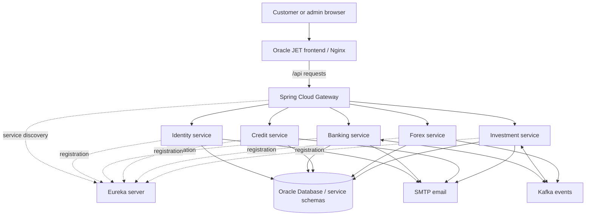

# O-Bank NetBanking

### Banking application built with Spring Boot microservices and Oracle JET

**Project maintainer: [Shashi Madari](https://github.com/ShashiMadari)**

**Repository: [ShashiMadari/NetBanking-SpringBoot](https://github.com/ShashiMadari/NetBanking-SpringBoot)**

O-Bank brings customer banking and bank administration into one application. It covers accounts, payments, cards, loans, foreign exchange, and investments, with OTP authorization, notifications, audit records, and scheduled processing.

The backend uses separate Spring Boot services with Eureka discovery and an API gateway. The frontend uses Oracle JET and TypeScript. Oracle Database stores application data, Kafka carries asynchronous events, and Podman runs the application containers.

> **Run the published stack:** all **10 container images**, including Oracle and Kafka, are public on Quay.io. Start with **[DEPLOY-FULL.md](DEPLOY-FULL.md)** to pull and run them without building the application locally.

## Contents

- [Features](#features)
- [Architecture](#architecture)
- [Technology stack](#technology-stack)
- [Directory structure](#directory-structure)
- [Services and ports](#services-and-ports)
- [Requirements](#requirements)
- [Run published containers](#run-published-containers)
- [Setup and startup](#setup-and-startup)
- [Container commands](#container-commands)
- [Scheduled processing](#scheduled-processing)
- [Demo walkthrough](#demo-walkthrough)
- [Local development](#local-development)
- [Troubleshooting](#troubleshooting)
- [Configuration notes](#configuration-notes)
- [Maintainer](#maintainer)

## Features

### Customer banking

| Area | Features |
| --- | --- |
| Identity | Registration for provisioned customers, password and OTP sign-in, password recovery, and profile management |
| Accounts | Current and savings summaries, balances, transaction history, and statements |
| Payments | Beneficiaries, fund transfers, bill payments, and payment authorization |
| Cards and rewards | Debit and credit card controls, daily limits, PIN management, merchant purchases, and reward points |
| Credit and loans | Credit-card repayments, EMI plans and payments, loan details, and statements |
| Forex | Currency wallets, exchange quotes with expiry, conversions, Forex cards, beneficiaries, remittances, and statements |
| Investments | Mutual funds, stocks, ETFs, fixed deposits, recurring deposits, PPF, portfolio holdings, and recurring schedules |
| Communication | In-app notifications, email delivery, PDF statements, and EMI reminders |

### Bank administration

- Review pending beneficiaries and manage accounts.
- Review payments and eligible payment reversals.
- Manage merchants and reward eligibility.
- Review merchant purchases and reverse successful purchases with a reason.
- Manage Forex KYC, base rates, markup, currency availability, and compliance review.
- Review investment orders, recurring schedules, and matured FDs awaiting manual settlement.
- Inspect audit events.

Admin backend endpoints require the administrator role. Creating an ordinary customer account does not grant administrator access.

## Architecture



The browser sends API calls through Nginx to the gateway. The gateway resolves backend services through Eureka. Services also use internal HTTP calls where required. Kafka supports asynchronous workflows such as investment order debit requests and their banking results.

### Container design

- **Backend:** a multi-stage `Containerfile.service` builds a JAR using Maven and runs it on a Java 17 runtime image.
- **Frontend:** Nginx serves generated frontend files and forwards `/api` requests to the gateway.
- **Configuration:** Compose supplies credentials and service settings through environment variables.
- **Windows demo:** `run-mirrored.ps1` manages the WSL mirrored networking configuration.
- **Image sharing:** `publish-quay.ps1` tags and pushes application images to a supplied Quay namespace.

## Technology stack

| Layer | Technology |
| --- | --- |
| Backend | Java 17, Spring Boot, Spring Security, JDBC, and Maven |
| Frontend | Oracle JET 17, TypeScript, Knockout, HTML, and CSS |
| API routing | Spring Cloud Gateway |
| Discovery | Netflix Eureka |
| Authentication | JWT and OTP flows |
| Database | Oracle Database and PL/SQL procedures |
| Messaging | Apache Kafka |
| Email and documents | SMTP email and PDF statement generation |
| Containers | Podman, Podman Compose, Red Hat UBI Java images, and Nginx |
| Image registry | Quay.io publishing support |

## Directory structure

```text
NetBanking-SpringBoot/
|-- eureka-server/                  # Service registry
|-- o-back-gateway/                 # API routes and discovery
|-- o-back-identity/                # Users, authentication, notifications, audit
|-- o-back-banking/                 # Accounts, beneficiaries, transfers, payments
|-- o-bank-credit/                  # Cards, rewards, merchant purchases, loans
|-- o-bank-forex/                   # Exchange, wallets, cards, KYC, remittances
|-- o-bank-investment/              # Orders, holdings, valuation, recurring plans
|   `-- src/main/resources/db/      # Included investment schema/migration SQL
|-- frontend/
|   |-- src/
|   |   |-- ts/viewModels/          # Page logic and API calls
|   |   |-- ts/views/               # Page templates
|   |   |-- ts/services/            # Shared frontend services
|   |   |-- js/                     # JavaScript bootstrap/configuration
|   |   |-- css/                    # Styles and assets
|   |   `-- index.html              # Application shell
|   |-- scripts/hooks/             # Oracle JET build hooks
|   |-- package.json
|   |-- package-lock.json
|   |-- oraclejetconfig.json
|   |-- Containerfile              # Bridged frontend image
|   |-- Containerfile.mirrored     # Mirrored frontend image
|   |-- nginx.conf
|   `-- nginx.mirrored.conf
|-- Containerfile.service           # Shared backend image build
|-- compose.yaml                    # Bridged stack including Kafka
|-- compose.mirrored.yaml           # Windows host networking stack
|-- compose.full.yaml               # Published stack including Oracle and Kafka
|-- infrastructure/                # Database schema and dependency image builds
|-- run-mirrored.ps1                 # Build/start/stop/log wrapper
|-- run-full.ps1                     # Pull/start/stop the 10-container stack
|-- prepare-podman-env.ps1           # Creates private .env from template
|-- publish-quay.ps1                 # Application image publishing
|-- .env.example                    # Template without credentials
|-- .gitignore
|-- README-containers.md            # Additional container instructions
`-- README.md
```

Java service folders contain their own `pom.xml`, Maven wrappers, and `src/main` tree. Generated `frontend/web/` output appears after a frontend build and is not tracked in Git.

## Services and ports

These ports apply to the **Windows mirrored stack**:

| Component | Directory | Port |
| --- | --- | --- |
| Frontend / Nginx | `frontend` | `8001` |
| API gateway | `o-back-gateway` | `8443` |
| Identity | `o-back-identity` | `8444` |
| Banking | `o-back-banking` | `8445` |
| Credit and loans | `o-bank-credit` | `8446` |
| Forex | `o-bank-forex` | `8447` |
| Investments | `o-bank-investment` | `8449` |
| Eureka | `eureka-server` | `8761` |
| Existing Kafka broker | External dependency | `9092` |
| Existing Oracle listener | External dependency | `1522` |

The current demo uses HTTP, including on port 8443; the port number alone does not indicate HTTPS. The bridged frontend defaults to port `8000`. Avoid running both stacks on conflicting ports.

## Requirements

- Git.
- Java 17 and Maven, or the included Maven wrappers, for local backend development.
- Node.js and npm compatible with this Oracle JET 17 project. The project setup used Node.js 18; dependencies are recorded in `frontend/package-lock.json`.
- Oracle Database with the required schemas and test users, or the provided Oracle container for a fresh structure-only database.
- An accessible Kafka broker, or the provided Kafka container in the full stack.
- Podman for Windows with a running Podman machine and WSL mirrored networking configured.
- Python, including the `py` launcher, for the Windows Compose wrapper.
- SMTP credentials to demonstrate OTP email, statements, or reminders.

For the application-only route, database provisioning is a prerequisite. The **[full-stack route](DEPLOY-FULL.md)** now initializes all five application schemas automatically in a fresh Oracle container. Neither route includes customer records, catalogue seed data, or preconfigured user credentials.

## Run published containers

All **10 prebuilt images** are publicly available under **`quay.io/shashimadari`**, with tags **`demo-20261023`** and **`latest`**. Anonymous pulls were verified for every image. Use the dated tag for this release; `latest` can change with future publications.

| Component | Image repository |
| --- | --- |
| Frontend / Nginx | `quay.io/shashimadari/o-bank-frontend` |
| Eureka | `quay.io/shashimadari/o-bank-eureka` |
| Gateway | `quay.io/shashimadari/o-bank-gateway` |
| Identity | `quay.io/shashimadari/o-bank-identity` |
| Banking | `quay.io/shashimadari/o-bank-banking` |
| Credit and loans | `quay.io/shashimadari/o-bank-credit` |
| Forex | `quay.io/shashimadari/o-bank-forex` |
| Investments | `quay.io/shashimadari/o-bank-investment` |
| Oracle Database | `quay.io/shashimadari/o-bank-oracle` |
| Kafka | `quay.io/shashimadari/o-bank-kafka` |

Browse [the public Quay namespace](https://quay.io/user/shashimadari/). The [release image inventory](container-images.json) records the verified registry digests for all 10 images.

### Full stack: application, Oracle, and Kafka

From the cloned repository root, create `.env`:

```powershell
powershell -NoProfile -ExecutionPolicy Bypass -File .\prepare-podman-env.ps1
```

Fill every runtime credential in `.env`, including `ORACLE_PWD` and the five schema passwords. Set the registry and release:

```dotenv
IMAGE_REGISTRY=quay.io/shashimadari
IMAGE_TAG=demo-20261023
ORACLE_HOST_PORT=1522
```

If an existing Oracle listener uses port 1522, choose `ORACLE_HOST_PORT=11522`. Start the Podman machine if it is stopped, then pull and run all 10 services:

```powershell
powershell -NoProfile -ExecutionPolicy Bypass -File .\run-full.ps1 pull
powershell -NoProfile -ExecutionPolicy Bypass -File .\run-full.ps1 up -d
powershell -NoProfile -ExecutionPolicy Bypass -File .\run-full.ps1 ps
```

Wait for dependency health checks and service registration, then open **<http://localhost:8001>**. Use `run-full.ps1 down` to stop the stack while keeping its named data volumes. Do not add `--build` for these published images.

The Oracle image initializes **55 empty application tables** across five schemas, including stored packages, constraints, indexes, and triggers. Use the optional [demo-data setup script](DEPLOY-FULL.md#add-your-own-demo-users-and-data) to add two customers, an admin, funded accounts and reference data locally, or provision your own records. Infrastructure passwords come from your private `.env`; customer records and pre-created logins are not bundled in the image.

See **[the full deployment guide](DEPLOY-FULL.md)** for networking requirements, password settings, persistence, logs, and image build instructions.

### Alternative: use existing Oracle and Kafka

Use **[the application-only guide](DEPLOY-QUAY.md)** and `run-mirrored.ps1` if Oracle and Kafka already run separately. The published images target Linux/AMD64 and the Windows WSL mirrored stack. Neither published route requires a local application build. The source-build instructions below are the alternative for development with external dependencies.

## Setup and startup

### 1. Clone the repository

```powershell
git clone https://github.com/ShashiMadari/NetBanking-SpringBoot.git
cd NetBanking-SpringBoot
```

Run container commands from this repository root unless a step changes directories.

### 2. Prepare Oracle and Kafka

Provision the service schemas and required PL/SQL procedures in Oracle. Configure each schema's password through the environment settings below.

For the mirrored demo, Oracle must be reachable at `localhost:1522/FREEPDB1` and Kafka at `localhost:9092` from the container environment. Adjust `compose.mirrored.yaml` if your addresses differ. The mirrored Compose file does not start Oracle or Kafka.

### 3. Create the private configuration file

```powershell
powershell -NoProfile -ExecutionPolicy Bypass -File .\prepare-podman-env.ps1
```

Edit the generated `.env` file and fill in these settings:

| Variables | Purpose |
| --- | --- |
| `IDENTITY_DB_PASSWORD`, `BANKING_DB_PASSWORD`, `CREDIT_DB_PASSWORD`, `FOREX_DB_PASSWORD`, `INVESTMENT_DB_PASSWORD` | Password for each Oracle service schema |
| `MAIL_USERNAME`, `MAIL_PASSWORD` | SMTP sender credentials |
| `JWT_SECRET` | Shared Base64 signing secret; use sufficient random bytes for the signing algorithm |
| `IDENTITY_API_KEY`, `BANKING_API_KEY`, `INVESTMENT_SERVICE_KEY` | Internal service authentication values |
| `IMAGE_REGISTRY`, `IMAGE_TAG` | Local defaults: `localhost` and `dev` |
| `ORACLE_JDBC_URL` | Oracle connection URL used by the bridged stack |
| `FRONTEND_PORT`, `GATEWAY_PORT`, `EUREKA_PORT` | Published port settings used by the bridged stack |

The mirrored stack defines its ports and Oracle URL directly in `compose.mirrored.yaml`; the `.env` port variables do not change those values.

Keep `.env` private. Compose loads it for containers; Maven and IDE launches need their environment variables configured separately.

### 4. Build the frontend

```powershell
cd frontend
npm ci
npx ojet build
cd ..
```

The frontend Containerfiles copy generated `web/` files. Complete this step before building a frontend container.

### 5. Start Podman and obtain base images

Check whether a Podman machine exists:

```powershell
podman machine list
```

For first-time setup only, create one:

```powershell
podman machine init
```

Start the existing machine if stopped, then check the connection:

```powershell
podman machine start
podman info
```

The mirrored wrapper uses `--pull=never`, so obtain these base images first:

```powershell
podman pull registry.access.redhat.com/ubi9/openjdk-17:latest
podman pull registry.access.redhat.com/ubi9/openjdk-17-runtime:latest
podman pull registry.access.redhat.com/ubi9/nginx-124:latest
```

### 6. Build and start the application

```powershell
powershell -NoProfile -ExecutionPolicy Bypass -File .\run-mirrored.ps1 up -d --build
powershell -NoProfile -ExecutionPolicy Bypass -File .\run-mirrored.ps1 ps
```

The wrapper creates a local Python environment and installs its Compose provider when needed. Backend image builds package the services with tests skipped; this command is not a test run.

### 7. Open the application

- **Application:** <http://localhost:8001>
- **Eureka dashboard:** <http://localhost:8761>
- **API gateway base URL:** `http://localhost:8443`

Allow time for services to register. Use a provisioned customer account to complete registration/sign-in and an existing administrator account for admin features.

## Container commands

```powershell
# Show container status
powershell -NoProfile -ExecutionPolicy Bypass -File .\run-mirrored.ps1 ps

# Start existing images
powershell -NoProfile -ExecutionPolicy Bypass -File .\run-mirrored.ps1 up -d

# Rebuild application images and start
powershell -NoProfile -ExecutionPolicy Bypass -File .\run-mirrored.ps1 up -d --build

# Read recent logs
powershell -NoProfile -ExecutionPolicy Bypass -File .\run-mirrored.ps1 logs --tail=100

# Follow Investment logs
powershell -NoProfile -ExecutionPolicy Bypass -File .\run-mirrored.ps1 logs -f o-bank-investment

# Read Credit and Loan logs
powershell -NoProfile -ExecutionPolicy Bypass -File .\run-mirrored.ps1 logs --tail=200 o-bank-credit

# Stop and remove application containers
powershell -NoProfile -ExecutionPolicy Bypass -File .\run-mirrored.ps1 down
```

The wrapper's `--build` option builds all application images. After changing frontend source, regenerate `frontend/web/` before rebuilding. Stopping the mirrored stack does not delete Oracle data or stop the separately managed Kafka broker.

### Publish images to Quay

Once local images exist, supply your Quay namespace:

```powershell
.\publish-quay.ps1 -Namespace YOUR_QUAY_NAMESPACE -Tag dev
```

The script logs in, tags, and pushes eight application images. A GitHub source-code push does not publish container images. See [README-containers.md](README-containers.md) for bridged deployment and image publishing details.

## Scheduled processing

The checked-in configuration includes accelerated timings for demonstrations:

| Scheduled task | Service | Current configuration / behavior |
| --- | --- | --- |
| Monthly account statements | Banking | Polls every minute for the eligible statement period |
| Monthly credit-card statements | Credit | Runs at second 10 of each minute |
| Monthly loan statements | Credit | Runs at second 20 of each minute |
| Credit-card EMI reminders | Credit | Runs at second 30; selects eligible installments due in three days |
| Loan EMI reminders | Credit | Runs at second 40; selects eligible installments due in three days |
| Payment OTP expiry cleanup | Banking | Default cron runs every minute |
| Recurring investment debit | Investment | Checks due schedules every 60 seconds |
| Investment market valuation | Investment | Runs every 60 seconds |
| Stock / ETF settlement | Investment | Checks every 15 seconds after a configured 60-second settlement delay |
| FD maturity | Investment | Checks every hour; marks due active FDs `MATURED` |
| Forex rate simulation | Forex | Jitter enabled; runs every 60 seconds |

Fixed delays are measured between executions and are not exact completion deadlines. Statement/reminder delivery records prevent repeated sends for already processed items. Eligibility and existing records affect each run.

Forex jitter simulates rate movements; it is not a live external market feed. FD maturity marks deposits for manual settlement and sends a notification; it does not automatically pay out the deposit. Adjust demo cron settings for a different operating schedule.

## Demo walkthrough

Use provisioned demo users, funded test accounts, and a test mailbox.

| Step | What to demonstrate | Evidence to show |
| --- | --- | --- |
| 1 | Containers and discovery | Container status and Eureka registrations |
| 2 | Customer OTP sign-in | OTP email and authenticated dashboard |
| 3 | Accounts and banking | Balances, history, and an authorized test payment |
| 4 | Merchant purchase and admin reversal | Successful purchase, reversal reason, `REVERSED` status, and card activity |
| 5 | Forex KYC and conversion | Admin approval, fresh quote countdown, receipt, and wallet balance |
| 6 | Fixed deposit | Selected tenure and maturity date in portfolio holdings |
| 7 | SIP / recurring investment | Due schedule, new order, banking debit result, and installment count |
| 8 | Stock / ETF settlement | Paid order changes from `SETTLEMENT_PENDING` to `ALLOTTED`; holding becomes active |
| 9 | Scheduled communication | Statement PDFs, EMI reminder emails, and corresponding logs |
| 10 | Admin review | Payment operations, Forex settings, investment schedules, and audit events |

Recurring debit demos require an unused schedule/date reference. Reusing a processed date does not create a fresh installment. Check order and transaction results before attempting another debit.

## Local development

To run a backend outside Podman, provide its required environment variables in your shell or IDE, then use its Maven wrapper. Example:

```powershell
cd o-back-identity
.\mvnw.cmd spring-boot:run
```

Start discovery and dependencies first, and avoid conflicts with running containers. Refer to the service configuration for required variables.

To run a service's existing tests:

```powershell
cd o-back-identity
.\mvnw.cmd test
```

Some tests require configured dependencies. This repository does not claim full automated end-to-end coverage.

## Troubleshooting

| Symptom | What to check |
| --- | --- |
| `run-mirrored.ps1` not found | Open a terminal in the repository root |
| Cannot connect to Podman | Inspect `podman machine list`, start the machine, and run `podman info` |
| Frontend image cannot find `web/` | Run `npm ci` and `npx ojet build` inside `frontend/` |
| Base image missing | Pull the three Red Hat images listed above |
| Oracle connection/login failure | Check listener, schemas, passwords, and the chosen Compose file's JDBC URL |
| Kafka failure or pending order | Check broker availability, advertised listener, and Banking/Investment consumer logs |
| OTP or statement email missing | Check SMTP settings, mailbox/spam, eligibility, and delivery records |
| Invalid CORS request | Check browser origin against Gateway/service CORS settings; changing hostname or port changes the origin |
| HTTP 504 or uncertain payment result | Inspect logs and saved results; use the existing request's retry/status flow before starting another payment |
| UI shows old content | Regenerate frontend files, rebuild its image, and reload the browser page |
| Scheduler runs without new output | Check due dates, status, delivery records, and whether the item was already processed |

## Configuration notes

- Shared application configuration uses environment placeholders for credentials.
- `.env` is ignored by Git; `.env.example` documents required settings.
- Generated files, local environments, dependencies, and logs are excluded.
- No private database exports or pre-funded demo customer data are included.
- The full deployment initializes empty application schemas; users, accounts, and reference/catalogue data must be provisioned separately.
- Demo rates, accelerated scheduler timings, and manual FD maturity settlement are documented above.
- Startup on another machine depends on its database, Kafka, mail, and networking setup.

## Maintainer

**Shashi Madari**

GitHub: [@ShashiMadari](https://github.com/ShashiMadari)

Project: [NetBanking-SpringBoot](https://github.com/ShashiMadari/NetBanking-SpringBoot)

When reporting an issue, include the module, reproduction steps, and relevant logs with passwords, tokens, and customer data removed. Use the repository's [Issues page](https://github.com/ShashiMadari/NetBanking-SpringBoot/issues) if enabled.
